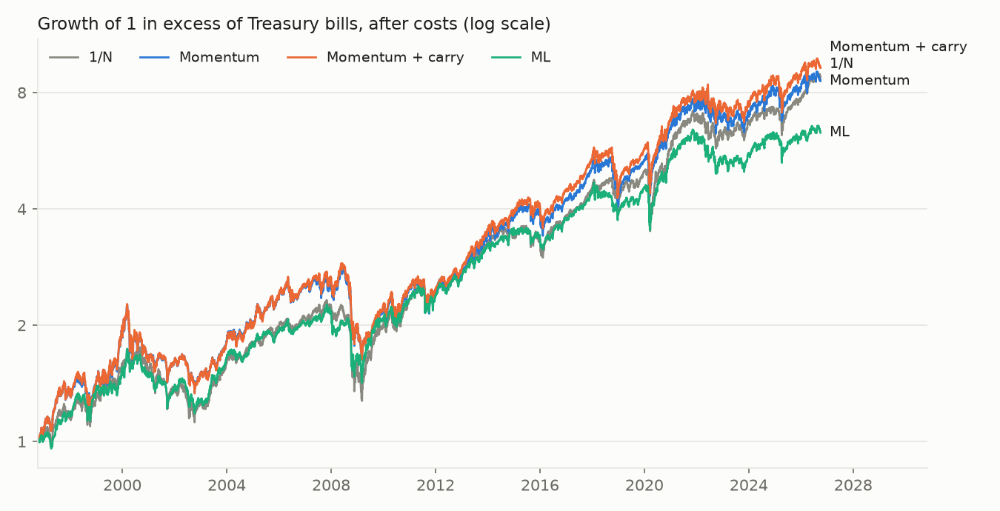
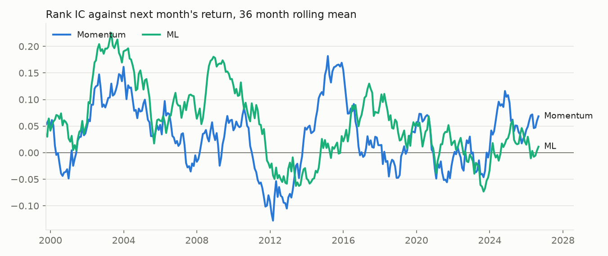

# Alpha Engine

[](https://github.com/rxj0102/Alpha-Engine/actions/workflows/ci.yml)

**Question.** In a 13 asset portfolio of equities, sectors, bonds and oil, does a machine learning return forecast add anything over 1/N, momentum and bond carry, once it is tested on 30 years of data with one portfolio construction and realistic costs?

<!-- headline:start (generated by scripts/render_readme.py, do not edit by hand) -->
**Answer.** Over 30 years out of sample (1996 to 2026, 361 monthly rebalances), no. Every source of views ends up with a lower Sharpe ratio than the 1/N portfolio it starts from: 1/N 0.60, momentum 0.54, momentum plus carry 0.55, ML 0.56. None of the differences is statistically significant (smallest p = 0.40).

The ML model is not noise. It ranks the 13 assets better than chance (mean rank IC 0.052, t = 2.4), slightly ahead of momentum (0.037, t = 1.5), and before costs its portfolio has a Sharpe ratio of 0.68 against 0.60 for 1/N. Two things undo it. It turns over 6.7 times its capital a year, against 2.6 for momentum, and trading costs take the whole gain. And the skill is old: the mean IC was 0.10 in 1996-2006 and 0.13 in 2007-2009, then 0.02 in 2010-2019 and -0.01 since 2020.
<!-- headline:end -->

So the result is a negative one with a clear mechanism: a small ranking signal that is too weak, too fast and too dated to pay for its own trading in a long-only portfolio. Every number on this page is written by `scripts/reproduce.py` and CI fails if the page drifts from the results files.



## Design

The experiment changes one thing at a time. Every portfolio uses the same 13 assets, the same month-end rebalance dates, the same covariance estimate, the same Black-Litterman prior, the same optimiser and the same trading costs. Only the views differ.

| Portfolio | Views |
|---|---|
| 1/N | None. This is the Black-Litterman prior, so it is the natural benchmark. |
| Inverse volatility | None. Weights proportional to 1 / volatility. A second benchmark that uses no forecast. |
| Momentum | Return from 12 months ago to 1 month ago, divided by volatility, ranked across the 13 assets. |
| Carry (bonds) | Yield minus the bill rate plus roll-down, for the three bond series only, measured against each series' own history. |
| Momentum + carry | The average of the two scores. |
| ML | One pooled model for all assets: ridge and gradient boosting on 18 technical features, averaged. |

**From a score to a view.** Each signal produces a z-score per asset. A z-score becomes an expected return through alpha = IC x volatility x z (Grinold 1994), with the same assumed IC of 0.05 for every signal. No signal gets a louder voice than another; they differ only in how they rank the assets.

**Black-Litterman.** The prior is the set of returns under which 1/N is optimal, PI = delta x Sigma x w, because there is no free source of market capitalisations for this universe. Views enter with the proportional uncertainty of He and Litterman (1999) and confidence 0.65. Under that choice the scaling parameter tau cancels out of the posterior mean, and when every asset has a view the posterior is simply the prior plus 0.65 times the alpha. Black-Litterman does real work only for the carry views, which cover three assets: the covariance matrix carries them over to the correlated assets. Both facts are unit tested.

**Optimiser.** Mean-variance, long-only, fully invested, at most 30% in one asset, risk aversion 2.5, Ledoit-Wolf covariance from the last 504 days.

**The ML model.** Each training row is one asset on one month-end. Features are ranked across assets on that date, as in Gu, Kelly and Xiu (2020). The target is the next month's return divided by volatility, relative to the average asset. The model is refitted every month on all earlier rows. Hyperparameters were fixed before the run and never tuned.

**Timing.** Signals for a trade at the close of day t use data up to day t-1. The most recent training month is left out of every fit because its outcome is only known at the close being traded. Tests perturb the rebalance-day price and the later labels and check that the forecast does not move.

**Costs.** Each trade pays half the bid-ask spread plus 5 bp commission, between 8 bp and 15 bp per side depending on the asset. These are ETF-era costs applied to the whole sample.

**Fixed in advance.** The signals, the model, the assumed IC, the confidence and the costs were all set before the 30 year run. The four forecast portfolios and both learners are reported in full, and the significance tests count them as four trials.

## Results

<!-- results:start (generated by scripts/render_readme.py, do not edit by hand) -->
Out-of-sample period 1996-10-01 to 2026-09-30: 7547 trading days, 361 month-end rebalances, 29.9 years. Data start 1990-07-02; the first 60 months train the first model. Returns are after trading costs. Sharpe ratios use daily returns in excess of the Treasury bill rate, with a 95% block bootstrap interval (2000 draws, 21 day blocks). The ML training set grows from 754 asset-months at the first forecast to 5460 at the last.

**Performance**

| Portfolio | Excess return | Volatility | Sharpe (95% interval) | Max drawdown | Turnover per year | Bonds, average weight |
|---|---|---|---|---|---|---|
| 1/N | 8.2% | 13.7% | 0.60 (0.24 to 0.99) | -44% | 0.2x | 23% |
| Inverse volatility | 6.6% | 9.2% | 0.72 (0.32 to 1.13) | -28% | 0.4x | 43% |
| Momentum | 8.3% | 15.3% | 0.54 (0.21 to 0.92) | -42% | 2.6x | 20% |
| Carry (bonds) | 7.8% | 14.3% | 0.54 (0.16 to 0.96) | -44% | 1.0x | 22% |
| Momentum + carry | 8.7% | 15.7% | 0.55 (0.21 to 0.93) | -43% | 2.5x | 17% |
| ML | 6.9% | 12.3% | 0.56 (0.20 to 0.95) | -36% | 6.7x | 27% |
| US market | 9.5% | 19.3% | 0.49 (0.18 to 0.86) | -55% | n/a | n/a |

**Value added over 1/N**, the portfolio every forecast strategy starts from

| Views | Active return | Tracking error | Information ratio | t | Sharpe difference (95% interval) | p | Deflated Sharpe Ratio |
|---|---|---|---|---|---|---|---|
| Momentum | 0.1% | 7.0% | 0.01 | 0.07 | -0.05 (-0.24 to +0.13) | 0.59 | 0.25 |
| Carry (bonds) | -0.4% | 3.4% | -0.11 | -0.60 | -0.05 (-0.16 to +0.06) | 0.40 | 0.09 |
| Momentum + carry | 0.4% | 6.8% | 0.06 | 0.33 | -0.05 (-0.22 to +0.13) | 0.62 | 0.35 |
| ML | -1.2% | 5.6% | -0.22 | -1.21 | -0.04 (-0.19 to +0.12) | 0.63 | 0.03 |

Active return is the monthly return minus the 1/N return (360 months). The Deflated Sharpe Ratio is the probability that the true information ratio beats the best of 4 skill-free trials (hurdle 0.13 a year); above 0.95 would be evidence of skill.

**Forecast skill**: rank correlation across assets between each score and next month's volatility-scaled return

| Score | Mean IC | Newey-West t | p | Months positive |
|---|---|---|---|---|
| Momentum | 0.037 | 1.51 | 0.132 | 54% |
| ML ridge | 0.057 | 2.71 | 0.007 | 54% |
| ML gradient boosting | 0.045 | 2.12 | 0.034 | 52% |
| ML | 0.052 | 2.40 | 0.016 | 54% |
| Low volatility | 0.024 | 0.98 | 0.325 | 53% |
| Momentum, equities only | 0.024 | 1.04 | 0.298 | 51% |
| ML, equities only | 0.043 | 2.02 | 0.044 | 52% |
| ML minus Momentum | 0.015 | 0.52 | 0.601 | 48% |
| ML minus Low volatility | 0.028 | 1.49 | 0.136 | 51% |

360 months per row. With the observed month to month dispersion of the ML IC (0.40), a mean IC below 0.042 could not reach t = 2 in this sample. The ML and momentum scores have a rank correlation of 0.29.

**By period**

| | 1996-2006 | 2007-2009 | 2010-2019 | 2020-2026 |
|---|---|---|---|---|
| Sharpe, 1/N | 0.64 | 0.03 | 0.87 | 0.63 |
| Sharpe, Inverse volatility | 0.86 | 0.22 | 1.17 | 0.37 |
| Sharpe, Momentum | 0.68 | -0.14 | 0.74 | 0.51 |
| Sharpe, Carry (bonds) | 0.61 | 0.09 | 0.90 | 0.41 |
| Sharpe, Momentum + carry | 0.67 | -0.12 | 0.78 | 0.50 |
| Sharpe, ML | 0.69 | 0.14 | 0.79 | 0.42 |
| Sharpe, US market | 0.37 | -0.09 | 0.88 | 0.65 |
| Mean IC, Momentum | 0.061 | 0.042 | 0.016 | 0.027 |
| Mean IC, ML | 0.102 | 0.126 | 0.016 | -0.006 |

**Robustness**: Sharpe ratio when one assumption changes

| Change | 1/N | Momentum | Carry (bonds) | Momentum + carry | ML |
|---|---|---|---|---|---|
| Base case | 0.60 | 0.54 | 0.54 | 0.55 | 0.56 |
| No costs | 0.60 | 0.58 | 0.56 | 0.59 | 0.68 |
| Double costs | 0.59 | 0.51 | 0.53 | 0.52 | 0.44 |
| Assumed IC 0.025 | same | 0.57 | 0.57 | 0.57 | 0.57 |
| Assumed IC 0.10 | same | 0.51 | 0.53 | 0.52 | 0.55 |

**Partial trading**: each month the portfolio moves only part of the way to its new target, w + k (target - w), the rule of Garleanu and Pedersen (2013) with a fixed rate k. Sharpe ratio, with turnover per year in brackets.

| Trade rate k | 1/N | Momentum | Carry (bonds) | Momentum + carry | ML |
|---|---|---|---|---|---|
| 1 (base case) | 0.60 (0.2x) | 0.54 (2.6x) | 0.54 (1.0x) | 0.55 (2.5x) | 0.56 (6.7x) |
| 0.5 | 0.61 (0.1x) | 0.56 (1.5x) | 0.55 (0.6x) | 0.56 (1.5x) | 0.57 (3.2x) |
| 0.25 | 0.61 (0.1x) | 0.56 (1.0x) | 0.55 (0.4x) | 0.56 (0.9x) | 0.59 (1.6x) |

Trading a quarter of the way each month cuts the ML portfolio's turnover from 6.7x to 1.6x a year and lifts its Sharpe ratio from 0.56 to 0.59, but 1/N gains too and ML still trails it (difference -0.02, p = 0.63). No forecast strategy beats 1/N at either rate. The rates 0.5 and 0.25 were chosen after the base case was published and both are shown; neither was picked from the results.

Bond carry as a timing signal: regressing next month's volatility-scaled excess return of the three bond series on the carry z-score gives a slope of 0.083 (t = 1.76, p = 0.079, 1080 observations, standard errors clustered by month).
<!-- results:end -->



## Reading the results

**A long-only Sharpe ratio says little about forecasts.** 1/N and the four forecast portfolios sit within a narrow band because all of them hold mostly equities and earn the equity premium. The honest measure of a forecast is the return it adds over the portfolio it starts from, so the tests are run on the active return against 1/N. On that measure nothing passes, and the ML portfolio is the furthest below zero. This matches the finding of DeMiguel, Garlappi and Uppal (2009) that 1/N is hard to beat out of sample.

**The ML signal is real but small.** Its rank IC is positive with a t-statistic above 2, and it survives two checks: it holds inside the nine equity series, where there is no bond-versus-oil tilt to learn, and a score that simply prefers low volatility assets has a lower IC that is not significant on its own. It is not reliably better than plain momentum; the difference between the two is well inside the noise. Four IC tests are shown, so the p-value of the best one should be read with that in mind.

**Costs decide it.** Without costs the ML portfolio is ahead of 1/N. With costs it is behind, and with double costs it is far behind. A monthly model on fast technical features changes its mind too often for the size of its edge. Novy-Marx and Velikov (2016) find the same pattern across equity anomalies: few strategies that turn over more than half their book a month survive costs. Trading only part of the way to each target, the standard remedy, cuts the ML turnover by three quarters and narrows the gap without closing it (table above).

**The edge has faded.** Almost all of the ML skill comes from before 2010. Since then its IC has been close to zero. A full-sample average hides this, which is why the period table matters more than the headline t-statistic.

**The benchmark that wins uses no forecast.** Inverse volatility has the highest Sharpe ratio in the table. It holds more bonds, and bonds had an exceptional run for most of this sample, so this is as much a statement about 1996 to 2020 as about risk weighting. Its weak 2020s row shows the other side.

**What 30 years can and cannot show.** The interval on a Sharpe difference is still wide after 30 years. The data can rule out a large edge from any of these signals in this construction. It cannot distinguish a small positive edge from a small negative one.

## Why the first version could not have worked

The original design trained a separate model for each asset on a 504 day window with a 21 day target. That is about 24 non-overlapping observations per model, for a stack of four learners and a meta-learner on 18 features, tested on three years. No amount of care downstream can rescue a forecast fitted that way, and three years cannot tell skill from luck at these effect sizes. The rebuild changes the two things that matter: the model is pooled across assets, so the training set is hundreds and then thousands of asset-months, and the test is ten times longer. The regime switch, the GARCH model and the minimum CVaR branch were removed, because each added thresholds that the evidence could not support.

## Data

All inputs are free and need no API key. `src/opendata.py` downloads them and `data/snapshot/` holds the frozen copy behind the results. Tickers are labels for readability; the series are the stand-ins below.

| Label | Open series |
|---|---|
| SPY | Ken French US market return (Mkt-RF + RF) |
| QQQ | FRED NASDAQ100 (price index, no dividends) |
| IWM | Ken French bottom 30% size portfolio |
| EFA | Ken French Developed ex US market (USD) |
| XLF, XLE, XLK, XLV, XLI | Ken French 12 industry portfolios: Money, Enrgy, BusEq, Hlth, Manuf |
| TLT, IEF | 20 year and 10 year constant maturity Treasury par bonds priced from FRED DGS20 and DGS10 |
| LQD | 12 year par bond priced from the FRED Baa corporate yield (DBAA) |
| USO | WTI spot price, FRED DCOILWTICO |
| Bill rate | Ken French daily RF |
| Carry inputs | FRED DGS7, DGS10, DGS20, DBAA |

The sample starts in July 1990, when the Developed ex US series begins. The 20 year yield was not published from 1987 to September 1993, so TLT joins in October 1993, before any out-of-sample date.

## Limitations

- The stand-ins are not tradable funds. The oil series is a spot price with no futures roll, the corporate bond series ignores defaults and downgrades, and the NASDAQ series excludes dividends. Costs from the ETF era are applied to the 1990s.
- The prior is 1/N and nine of the 13 assets are equities, so every portfolio is equity heavy.
- A long-only portfolio with a 30% cap can express only part of a ranking. A long-short construction would use more of it and was not tested. Time series momentum (Moskowitz, Ooi and Pedersen 2012), the form documented across asset classes, is long-short by construction, so the momentum tested here is a weak version.
- The model specification was fixed, not searched. Another specification could do better or worse.
- The turnover control was added after the base case was published, as a check on its main explanation: partial trading at two fixed rates, both shown. Because it came after the results, a win from it would not have counted as evidence; it is reported because it could only weaken the headline, and it did not. A turnover rule chosen in advance needs data this study has not touched.
- Carry is measured for bonds only. Equity and commodity carry need dividend forecasts and futures curves that are not in the free data.
- Thirteen assets make a thin cross-section, so each month's IC is noisy.

## Corrections to earlier versions

- The previous results covered 2022 to 2024 only. They are replaced, not extended; the old code and numbers are in the git history.
- The README used to list no-look-ahead features and out-of-fold stacking as research contributions. They are ordinary hygiene and are now described as such.
- It claimed that setting tau = 1/T materially changed the allocations. With proportional view uncertainty tau has no effect on the posterior mean. A test now proves this.
- The statistic labelled Deflated Sharpe Ratio was a ratio of the Sharpe ratio to a threshold and was credited to the wrong paper. It is now the probability defined by Bailey and Lopez de Prado (2014), applied to active returns.
- A fixed 4% risk-free rate was used. Excess returns now use the daily bill rate.
- The breadth figure of 156 independent bets a year treated 13 correlated assets as independent. It is removed.
- A factor analytics page reported t-statistics near 100 from overlapping rolling windows. It is deleted, along with the last Yahoo Finance code.
- Earlier fixes that still apply: purged cross-validation, no warm-up period counted as performance, a 1/N baseline, a correctly centred bootstrap.

## Reproduce

```bash
git clone https://github.com/rxj0102/Alpha-Engine.git
cd Alpha-Engine
uv sync                 # or: pip install -r requirements.txt
make test               # 44 tests, a few seconds
make reproduce          # about 4 minutes on a laptop, rewrites results/ and this page
make check              # confirms this page matches results/metrics.json
```

`python scripts/reproduce.py --refresh` downloads the data again and overwrites the snapshot. It also rewrites `results/open_data_manifest.json`, which records the SHA-256 and date range of every downloaded file. Ken French and FRED revise history from time to time, so refreshed numbers can differ slightly.

## Layout

```
src/config.py      every parameter, fixed before the run
src/opendata.py    FRED and Ken French loaders, bond pricing from yields
src/data.py        frozen snapshot, 18 causal features
src/signals.py     momentum, bond carry, z-scores, score to alpha
src/ml_alpha.py    pooled panel and walk-forward forecasts
src/optimizer.py   Ledoit-Wolf covariance, Black-Litterman posterior, mean-variance
src/backtest.py    backtest with costs, bootstrap tests, Deflated Sharpe Ratio, IC statistics
src/pipeline.py    the experiment
scripts/           reproduce.py writes results/, render_readme.py writes this page
tests/             44 tests, including look-ahead and leakage checks
results/           metrics.json, daily returns, monthly IC, weights, figures
```

## References

- Asness, C., Moskowitz, T. and Pedersen, L. (2013). Value and momentum everywhere. *Journal of Finance* 68(3).
- Bailey, D. and Lopez de Prado, M. (2014). The deflated Sharpe ratio. *Journal of Portfolio Management* 40(5).
- Black, F. and Litterman, R. (1992). Global portfolio optimization. *Financial Analysts Journal* 48(5).
- DeMiguel, V., Garlappi, L. and Uppal, R. (2009). Optimal versus naive diversification. *Review of Financial Studies* 22(5).
- Garleanu, N. and Pedersen, L. (2013). Dynamic trading with predictable returns and transaction costs. *Journal of Finance* 68(6).
- Grinold, R. (1994). Alpha is volatility times IC times score. *Journal of Portfolio Management* 20(4).
- Gu, S., Kelly, B. and Xiu, D. (2020). Empirical asset pricing via machine learning. *Review of Financial Studies* 33(5).
- He, G. and Litterman, R. (1999). The intuition behind Black-Litterman model portfolios. Goldman Sachs Investment Management Research.
- Koijen, R., Moskowitz, T., Pedersen, L. and Vrugt, E. (2018). Carry. *Journal of Financial Economics* 127(2).
- Ledoit, O. and Wolf, M. (2004). A well-conditioned estimator for large-dimensional covariance matrices. *Journal of Multivariate Analysis* 88(2).
- Moskowitz, T., Ooi, Y. H. and Pedersen, L. (2012). Time series momentum. *Journal of Financial Economics* 104(2).
- Novy-Marx, R. and Velikov, M. (2016). A taxonomy of anomalies and their trading costs. *Review of Financial Studies* 29(1).
- Politis, D. and Romano, J. (1992). A circular block-resampling procedure for stationary data. In *Exploring the Limits of Bootstrap*.
